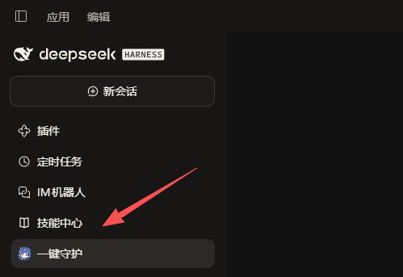
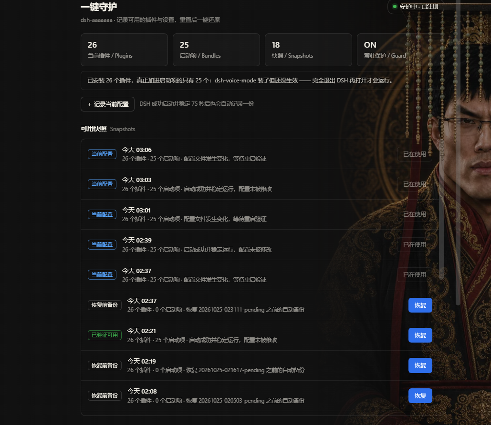
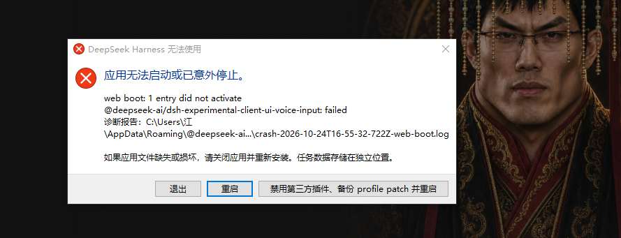

# 一键守护 · dsh-aaaaaaa

[English](README.en.md) | 简体中文

> 把「插件能正常工作」的那一份配置存下来。哪天 DSH 因为插件不兼容把你打回「禁用所有插件 + 清空设置」，回来点一下就能还原。

插件包名是 `dsh-aaaaaaa`，侧边栏和面板显示的名字是 **一键守护** —— 包名带 aaa 是为了在插件列表里排最前面，好找。

---

## 截图

### 侧边栏入口

在「新会话」下面那一列，排在「技能中心」底下：



### 面板

左上是当前插件数 / 启动项数 / 快照数 / 常驻保护状态；下面是所有快照，点「恢复」即可写回。



### 出事时你看到的是这个

插件不兼容导致启动失败，DSH 会弹出这个窗口。点「禁用第三方插件、备份 profile patch 并重启」就等于恢复出厂——之后回到面板点一次「恢复」，再完全退出重开即可。



## 它做什么

| 能力 | 说明 |
|---|---|
| 自动快照 | 每次启动记一份「待验证」；启动成功且 75 秒内配置没再变动，自动转成「已验证可用」 |
| 手动快照 | 面板上点「+ 记录当前配置」，随时存一份 |
| 一键恢复 | 选一份快照点「恢复」，把插件清单和设置写回当前 profile |
| 恢复前备份 | 每次恢复前先存一份「恢复前备份」，恢复错了还能退回去 |
| 自动清理 | 最多保留 15 份（其中「已验证可用」最多 10 份），超出自动删最旧的 |
| 强制保留自身 | 恢复任何快照都会把本插件的登记一并写回，插件列表不会因为恢复而缺它 |

侧边栏入口：**新会话下面那一列 → dsh-aaaaaaa**。

## 注意事项

1. **恢复后必须完全退出 DSH**（托盘也退掉）再重新打开，新的插件列表才会生效。
2. **被重置之后怎么回来**：重新打开 DSH → 进到「一键守护」面板 → 点「恢复」选一份快照 → 再完全退出重开。
3. 快照只记录 `package.json` 与 `cordis.patch.yml`。插件代码本身在 `~/.dsh/plugins` 和各插件自己的目录里，恢复**不会**帮你重装插件，只恢复「启用了哪些、设置成什么」。
4. 数据都在本地（`~/.dsh/guardian/`），不联网、不上传。
5. 「已验证可用」是自动判定的：启动后 75 秒内配置没变动才算。装完插件**没重启**时，它会显示成「待验证」，提示你重启确认。

## 安装

本地插件，装法：

1. 把 `dsh-aaaaaaa` 目录放到 `%USERPROFILE%\.dsh\plugins\dsh-aaaaaaa`；
2. 在 `%USERPROFILE%\.dsh\profiles\desktop\package.json` 里加：

   ```json
   "dependencies": { "dsh-aaaaaaa": "file:../../plugins/dsh-aaaaaaa" },
   "dsh": { "profile": { "bundles": [ "…原有项…", "dsh-aaaaaaa" ] } }
   ```

3. 建目录链接（PowerShell，普通权限即可）：

   ```bat
   cmd /c mklink /J "%USERPROFILE%\.dsh\profiles\desktop\node_modules\dsh-aaaaaaa" "%USERPROFILE%\.dsh\plugins\dsh-aaaaaaa"
   ```

4. 完全退出 DSH 再打开。

## 数据在哪

| 路径 | 内容 |
|---|---|
| `%USERPROFILE%\.dsh\guardian\snapshots\` | 所有快照（`package.json` + `cordis.patch.yml` + `meta.json`） |
| `%USERPROFILE%\.dsh\guardian\status.json` | 当前进程心跳（pid / 版本 / 启动项数） |
| `%USERPROFILE%\.dsh\guardian\guardian.log` | 插件日志 |

## 版本

| 版本 | 说明 |
|---|---|
| 1.3.3 | 看门狗改用 `run-hidden.vbs` 静默启动，不再每 5 分钟闪一次窗口 |
| 1.3.2 | 侧边栏那一行的名字也改成「一键守护」（包名/目录仍是 `dsh-aaaaaaa`，方便在插件列表里找） |
| 1.3.1 | 面板更名「一键守护」；说明改为中英双语；文案不再描述重置后的自动行为 |
| 1.3.0 | 改名 `dsh-aaaaaaa`；加看门狗；恢复/修复时强制保留自身；清掉旧包名残留 |
| 1.2.3 | 面板显示「常驻保护」状态与一键修复 |
| 1.2.2 | 恢复时不再剥离自身注册 |
| 1.2.1 | 面板与快照列表可滚动 |
| 1.2.0 | 侧边栏面板 + HTTP 接口 |
| 1.0.0 | 首个可用版本（快照引擎） |

## 可选：看门狗（重置后自动写回）

重置后插件本身不会被加载，面板自然不会出现。看门狗是一个**独立于 DSH 的小脚本**，由 Windows 计划任务每 5 分钟跑一次；它通过 `run-hidden.vbs` 静默启动，**平时看不到任何窗口、也不会闪屏**，每次结果只写进 `~/.dsh/guardian/watchdog.log`：

- 发现 profile 里的本插件登记被抹掉 → 立刻补回；
- 发现启动项被重置成「只剩官方」→ 自动写回最近一份**健康快照**，并把本插件重新并入。

安装（在仓库根目录执行）：

```powershell
New-Item -ItemType Directory -Force "$env:USERPROFILE\.dsh\aaaaaaa-watch" | Out-Null
Copy-Item .\watchdog\watchdog.ps1, .\watchdog\run.cmd, .\watchdog\run-hidden.vbs "$env:USERPROFILE\.dsh\aaaaaaa-watch\" -Force
schtasks /Create /F /TN "dsh-aaaaaaa watch" /SC MINUTE /MO 5 /TR "wscript.exe \"%USERPROFILE%\.dsh\aaaaaaa-watch\run-hidden.vbs\""
```

手动跑一次（想看到过程）：双击 `%USERPROFILE%\.dsh\aaaaaaa-watch\run.cmd`；计划任务用的是静默版 `run-hidden.vbs`。
关闭自动写回：在 `%USERPROFILE%\.dsh\guardian\watchdog.json` 里设 `{"autoRestore": false}`，看门狗就只做「补登记」，不碰你的配置。

> macOS / Linux 上不需要它，重置后重启一次 DSH 即可。

## 卸载

1. 删 `profiles/<name>/package.json` 里的 `dsh-aaaaaaa` 依赖与启动项；
2. 删 `profiles/<name>/node_modules/dsh-aaaaaaa` 链接与 `~/.dsh/plugins/dsh-aaaaaaa`；
3. 数据目录 `~/.dsh/guardian` 可留作备份，也可整目录删掉。

## License

MIT
